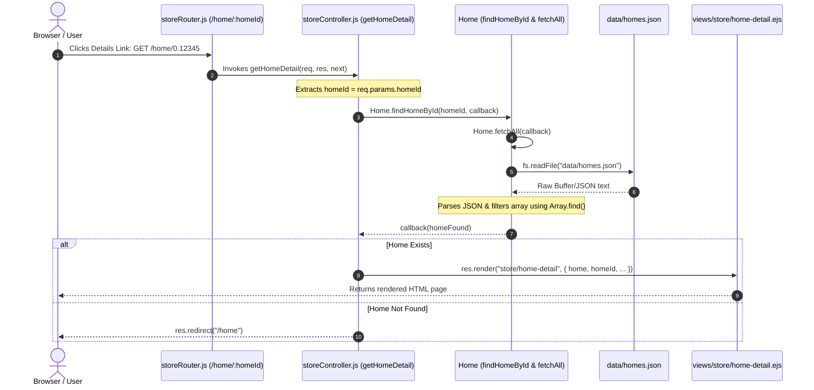

# Dynamic Path & Home Details: Code & Architecture Guide

This document explains the entire flow of fetching and displaying the details of an individual home by its dynamic ID (`/home/:homeId`), showing all related files, code blocks, and how they connect using the traditional asynchronous callback pattern in Node.js / Express.

---

## 1. High-Level Architecture (MVC Flow)



---

## 2. Where the Flow Begins: The Details Link

In **`views/store/home-list.ejs`**, each home card renders a dynamic URL pointing to its specific `id`:

```html
<!-- views/store/home-list.ejs (Lines 87-88) -->
<a class="bg-blue-400 py-2 px-2" href="/home/<%= home.id %>">Details</a>
```
When clicked, the browser sends a `GET` request to `/home/<homeId>` (for example: `/home/0.892461`).

---

## 3. The Route: `routes/storeRouter.js`

The route matches the dynamic segment `:homeId` and routes the request to `storeController.getHomeDetail`:

```javascript
// routes/storeRouter.js
const express = require("express");
const storeRouter = express.Router();
const storeController = require("../controllers/storeController");

// Dynamic Route: ":homeId" acts as a placeholder for any home ID
storeRouter.get("/home/:homeId", storeController.getHomeDetail);

module.exports = storeRouter;
```

---

## 4. The Controller: `controllers/storeController.js`

The controller acts as the orchestrator. It extracts the dynamic parameter, calls the model, and determines which HTTP response to return:

```javascript
// controllers/storeController.js (Lines 43-58)
const { Home } = require("../Models/home");

exports.getHomeDetail = (req, res, next) => {
  // 1. Extract dynamic route parameter ":homeId" from request params
  const homeId = req.params.homeId;

  // 2. Call the Model's asynchronous method with a callback
  Home.findHomeById(homeId, (home) => {
    // 3. Handle not found condition
    if (!home) {
      console.log("Home not found");
      res.redirect("/home");
    } else {
      // 4. Render the detail page passing the home object & metadata
      console.log(home);
      res.render("store/home-detail", {
        home,
        homeId,
        title: "Home Detail",
        currentPage: "home",
      });
    }
  });
};
```

---

## 5. The Model: `Models/home.js`

Because reading files from the disk using `fs.readFile` is asynchronous, data cannot simply be returned using `return`. Instead, it uses **traditional Node.js callbacks**.

```javascript
// Models/home.js
const fs = require("fs");
const path = require("path");
const rootDir = require("../utils/rootPathUtil");

class Home {
  id = Math.random();

  constructor(name, price, location, rating, photoUrl) {
    this.name = name;
    this.price = price;
    this.location = location;
    this.rating = rating;
    this.photoUrl = photoUrl;
  }

  // Reads data/homes.json and invokes callback with parsed array
  static fetchAll(callback) {
    const filePath = path.join(rootDir, "data", "homes.json");
    fs.readFile(filePath, (error, data) => {
      console.log("File reading complete", error);
      callback(!error ? JSON.parse(data) : []);
    });
  }

  // Searches the array for the matching ID
  static findHomeById(homeId, callback) {
    this.fetchAll((homes) => {
      const homeFound = homes.find(
        (home) => String(home.id) === String(homeId)
      );
      callback(homeFound);
    });
  }
}

exports.Home = Home;
```

### Deep Dive: How the Callback Chain Works Here
1. **Level 1 (`fs.readFile`)**: Reads from disk asynchronously. When finished, it invokes its callback `(error, data) => { ... }`.
2. **Level 2 (`Home.fetchAll`)**: Takes `callback`. Once `fs.readFile` produces `data`, it parses JSON and calls `callback(!error ? JSON.parse(data) : [])`.
3. **Level 3 (`Home.findHomeById`)**: Passes a callback to `fetchAll`. When given `homes`, it searches with `.find(...)`, then triggers its own `callback(homeFound)`.
4. **Level 4 (`storeController.getHomeDetail`)**: Supplies the top-level callback `(home) => { ... }` which receives the found home and renders the page.

---

## 6. The View: `views/store/home-detail.ejs`

The view receives `home` and `homeId` from the controller and injects the dynamic properties into the HTML:

```html
<!-- views/store/home-detail.ejs -->
<%- include('../partials/head') %>
<%- include('../partials/nav') %>

<body>
    <h1>You are on Home detail Page id <%= homeId %></h1>
    <div class="grid grid-cols-1 sm:grid-cols-2 lg:grid-cols-3 gap-6">
        <div class="group bg-white rounded-2xl overflow-hidden border border-slate-100 shadow-sm hover:shadow-md transition-all duration-200 flex flex-col">
            
            <!-- Photo -->
            <div class="relative w-full aspect-video bg-slate-100 overflow-hidden">
                " alt="<%= home.name %>" class="w-full h-full object-cover">
            </div>

            <!-- Details -->
            <div class="p-5 flex flex-col flex-grow justify-between">
                <div>
                    <!-- Location -->
                    <div class="flex items-center gap-1.5 text-xs font-semibold text-rose-600 mb-1.5 uppercase tracking-wider">
                        <span><%= home.location %></span>
                    </div>
                    <!-- Name -->
                    <h4 class="text-lg font-bold text-slate-800">
                        <%= home.name %>
                    </h4>
                </div>

                <!-- Price & Booking -->
                <div class="mt-4 pt-4 border-t border-slate-100 flex items-baseline justify-between">
                    <span class="text-xs text-slate-400 font-medium">Price</span>
                    <div class="text-right">
                        <span class="text-xl font-extrabold text-slate-900">$<%= home.price %></span>
                        <span class="text-xs text-slate-500 font-normal"> / night</span><br>
                        <button class="bg-green-500 py-2 px-2">Book</button>
                    </div>
                </div>
            </div>

        </div>
    </div>
</body>
</html>
```

---

## 7. Summary File Map

| Component | File Path | Role |
| :--- | :--- | :--- |
| **Link Trigger** | [views/store/home-list.ejs](file:///c:/Users/mkama/Desktop/Front-End/node/lec14-DynamicPaths/views/store/home-list.ejs) | Provides `<a href="/home/<%= home.id %>">` |
| **Router** | [routes/storeRouter.js](file:///c:/Users/mkama/Desktop/Front-End/node/lec14-DynamicPaths/routes/storeRouter.js) | Defines dynamic route `/home/:homeId` |
| **Controller** | [controllers/storeController.js](file:///c:/Users/mkama/Desktop/Front-End/node/lec14-DynamicPaths/controllers/storeController.js) | Receives request, calls model, returns response |
| **Model** | [Models/home.js](file:///c:/Users/mkama/Desktop/Front-End/node/lec14-DynamicPaths/Models/home.js) | Handles asynchronous file reading & filtering via callbacks |
| **Data Store** | `data/homes.json` | Persistent JSON file containing homes array |
| **View Template** | [views/store/home-detail.ejs](file:///c:/Users/mkama/Desktop/Front-End/node/lec14-DynamicPaths/views/store/home-detail.ejs) | Renders the HTML page for a single home |
